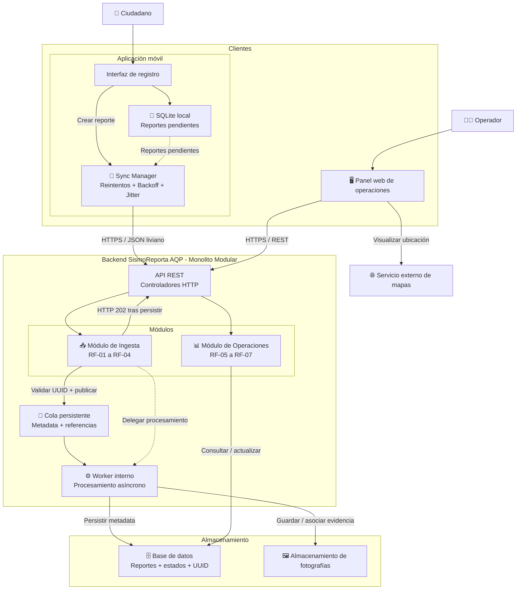
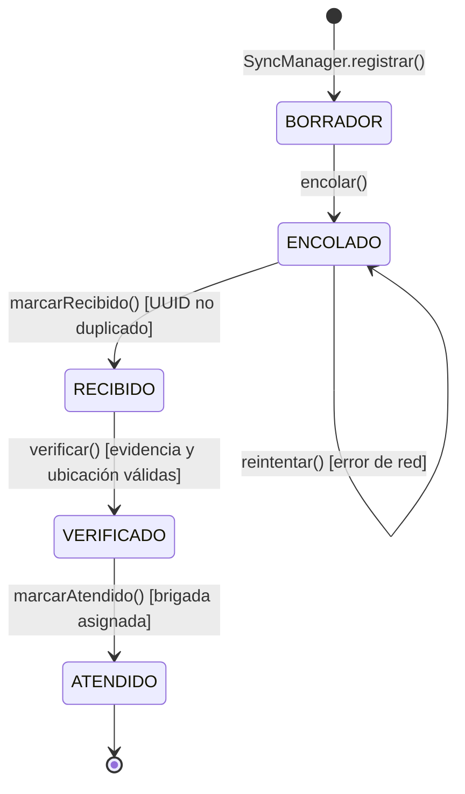
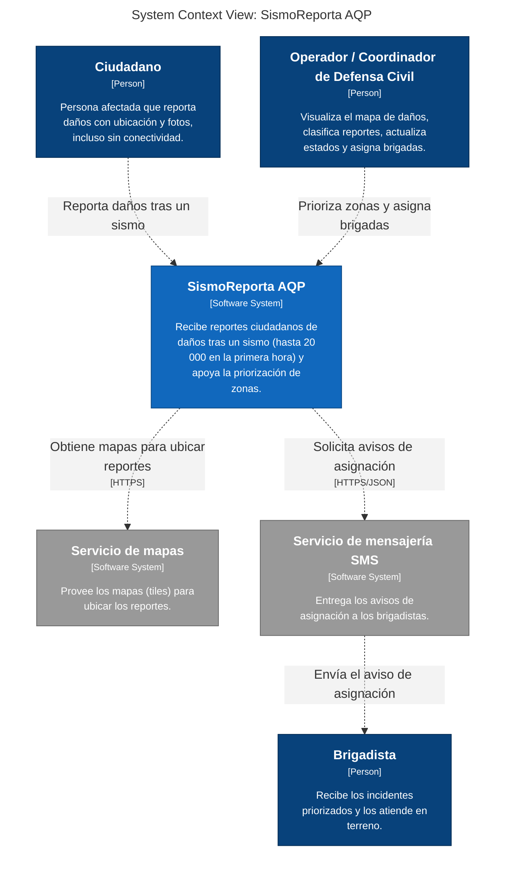

# SismoReporta AQP – Arquitectura y diseño (Laboratorios 04 a 07)

> **Universidad Nacional de San Agustín de Arequipa (UNSA)**  
> **Facultad de Ingeniería de Producción y Servicios — Escuela Profesional de Ingeniería de Sistemas**  
> **Curso:** Fundamentos de Arquitectura de Software (2026-B)  
> **Repositorio:** `cs-2026b-lab04-SismoReportaAQP-`

## Índice de laboratorios

| Lab | Tema | Sección | Carpeta | Tag |
|---|---|---|---|---|
| 04 | Arquitectura: drivers, matriz, ADR, diagramas | [1 a 6](#1-información-del-proyecto-y-caso-asignado) | `docs/architecture/` | — |
| 05 | UML como código (clases, secuencia, estados, actividades, paquetes) | [7](#7-diseño-uml-lab-05) | `docs/design/`, `src/` | `v0.5-diseno` |
| 06 | Modelo C4 con Structurizr DSL | [8](#8-arquitectura-c4-lab-06) | `docs/architecture/c4/` | `v0.6-c4` |
| 07 | Refactorización hacia patrones, IA simulada y pruebas | [9](#9-patrones-de-diseño-lab-07) | `docs/design/patrones/` | `v0.7-patrones` (pendiente de publicar) |

---

## 1. Información del Proyecto y Caso Asignado

* **Caso seleccionado:** **Caso 8 — SismoReporta AQP**
* **Contexto:** Plataforma ciudadana para el reporte ágil de daños en infraestructura tras un evento sísmico en la región Arequipa, orientada a brindar soporte táctico y priorización de zonas a brigadistas y personal de Defensa Civil.
* **Actores clave:**
  * **Ciudadano:** Registra reportes con coordenadas geográficas y evidencia fotográfica, incluso sin conectividad móvil inmediata.
  * **Operador / Coordinador de Defensa Civil:** Visualiza el mapa de calor/daños, filtra y clasifica incidentes, actualiza estados y asigna cuadrillas.
  * **Brigadista:** Recibe asignación de incidentes priorizados para atención en terreno.
* **Atributo de calidad crítico:** **Disponibilidad y Resiliencia ante picos extremos:** Capacidad de tolerar una ráfaga de hasta **20 000 reportes en la primera hora** posterior al sismo con la red celular congestionada, garantizando un enfoque *Offline-First* donde la app móvil almacena localmente y sincroniza de forma segura al restablecerse la señal.

---

## 2. Integrantes del Equipo y Roles

| Integrante | Correo Institucional | Rol Principal | Responsabilidades |
|---|---|---|---|
| **Josue Quispe Paucar** | `jquispepauc@unsa.edu.pe` | Arquitecto de Software | Definición de drivers (E1), matriz de decisión multicriterio (E2) y registros de decisiones ADR (E4). |
| **Gonzalo Cárdenas** | `gcardenas@unsa.edu.pe` | Ingeniero de Infraestructura y Despliegue | Modelado de diagramas Mermaid (E3), alternativa PlantUML (E5) y automatización de despliegue en Google Colab (E6). |
| **Colaborador / Auditor** | `grupo@unsa.edu.pe` | Analista de Calidad y Auditoría IA | Auditoría adversarial de IA (E7), redacción del informe técnico y revisión cruzada de PRs (E8). |

---

## 3. Diagrama de Arquitectura de la Solución Elegida (Mermaid)

La arquitectura adoptada corresponde a un **Monolito Modular con Ingesta Asíncrona Simplificada**, la cual desacopla la recepción inmediata de reportes de su procesamiento pesado y persistencia en base de datos.



---

## 4. Índice de Entregables del Laboratorio

| Entregable | Descripción | Enlace al Archivo | Artefactos Visuales |
|---|---|---|---|
| **E1** | Drivers arquitectónicos, atributos de calidad y escenarios en 6 partes | [`docs/architecture/drivers.md`](docs/architecture/drivers.md) | — |
| **E2** | Matriz de decisión ponderada multicriterio y auditoría de IA | [`docs/architecture/matriz-decision.md`](docs/architecture/matriz-decision.md) | A1 (4.40), A2 (3.90), A3 (3.35) |
| **E3** | Diagrama de arquitectura como código en Mermaid | [`docs/architecture/diagramas/arquitectura.mmd`](docs/architecture/diagramas/arquitectura.mmd) | [`Diagrama de Arquitectura.png`](docs/architecture/diagramas/img/Diagrama%20de%20Arquitectura.png) |
| **E4** | Registros de Decisiones Arquitectónicas (ADRs) | [`docs/architecture/adr/`](docs/architecture/adr/) | [ADR-001](docs/architecture/adr/001-estilo-arquitectonico.md), [ADR-002](docs/architecture/adr/002-sincronizacion-offline.md), [ADR-003](docs/architecture/adr/003-cola-procesamiento-asincrono.md) |
| **E5** | Diagrama de la alternativa descartada (PlantUML) | [`docs/architecture/diagramas/alternativa.puml`](docs/architecture/diagramas/alternativa.puml) | [`AlternativaPlantUML.png`](docs/architecture/diagramas/img/AlternativaPlantUML.png) |
| **E6** | Vista de despliegue físico y lógico (Python Diagrams / Colab / PlantUML) | [`despliegue.py`](docs/architecture/diagramas/despliegue.py) · [`despliegue_colab.ipynb`](docs/architecture/diagramas/despliegue_colab.ipynb) · [`despliegue.puml`](docs/architecture/diagramas/despliegue.puml) | [`despliegue.png`](docs/architecture/diagramas/img/despliegue.png) |
| **E7** | Bitácora de interacciones con IA (5 sesiones, correcciones y prompts) | [`docs/architecture/bitacora-ia.md`](docs/architecture/bitacora-ia.md) | Auditoría de 6 sesgos e IA adversarial |
| **E8** | README del repositorio y síntesis técnica grupal | [`README.md`](README.md) | Este documento |

---

## 5. Reflexión Grupal sobre el Aporte y Límites de la Inteligencia Artificial

Durante el desarrollo de este laboratorio, la Inteligencia Artificial demostró ser un catalizador valioso para explorar rápidamente alternativas de diseño, estructurar especificaciones técnicas y generar bocetos iniciales de diagramas como código. No obstante, comprobamos que la IA tiende recurrentemente a la sobreingeniería (como proponer clústeres de Kubernetes y Apache Kafka para cargas de 5.5 req/s) y a formular afirmaciones hiperbólicas no fundamentadas, tales como "escalabilidad infinita" o "garantía absoluta de cero fallos". La aplicación rigurosa de la regla de oro (*la IA propone, el equipo decide y verifica*) resultó imprescindible: contrastar cada recomendación contra las restricciones reales de un MVP a 1 mes y un equipo de 3 desarrolladores permitió depurar sesgos, rechazar servicios innecesarios y consolidar una arquitectura pragmática, eficiente y viable.

---

## 6. Instrucciones de Reproducción de los Diagramas

### A. Vista de Despliegue en Python (`despliegue.py`)
Para generar la imagen del diagrama de despliegue mediante la librería `diagrams` de Python:

#### Opción 1: En Google Colab (Recomendado)
1. Abrir el notebook [`docs/architecture/diagramas/despliegue_colab.ipynb`](docs/architecture/diagramas/despliegue_colab.ipynb) en Google Colab.
2. Ejecutar la celda de instalación de Graphviz y dependencias:
   ```bash
   !apt-get update -qq && !apt-get install -y -qq graphviz
   !pip install -q diagrams
   ```
3. Ejecutar el script y visualizar el resultado generado en `img/despliegue.png`.

#### Opción 2: Entorno Local con Linux
Asegurarse de contar con Graphviz y Python 3 en el sistema:
```bash
# Ubuntu/Debian:
sudo apt-get install -y graphviz
pip install diagrams

# Ejecutar el script:
python docs/architecture/diagramas/despliegue.py
```

### B. Vista de Despliegue Alternativa en PlantUML
En caso de restricciones de entorno local, se encuentra disponible [`docs/architecture/diagramas/despliegue.puml`](docs/architecture/diagramas/despliegue.puml), el cual puede visualizarse y compilarse directamente en [PlantUML Web Server](http://www.plantuml.com/plantuml) o mediante la extensión de PlantUML en VS Code / Antigravity IDE.

---

## 7. Diseño UML (Lab 05)

Historia crítica: [`historia.md`](docs/design/historia.md) · Caso 8 – enviar un reporte sin señal y sincronizarlo.

**Máquina de estados del Reporte (E3):**



| Entregable | Archivo | Imagen |
|---|---|---|
| E1 Clases | [`clases-lab05.puml`](docs/design/clases-lab05.puml) | [`clases-reportes.png`](docs/design/img/clases-reportes.png) |
| E2 Secuencia | [`secuencia-sincronizar-reporte.puml`](docs/design/secuencia-sincronizar-reporte.puml) | [`png`](docs/design/img/secuencia-sincronizar-reporte.png) |
| E3 Estados | [`estados-reporte.mmd`](docs/design/estados-reporte.mmd) | (render nativo arriba) |
| E4 Actividades | [`actividades-priorizar-asignar.puml`](docs/design/actividades-priorizar-asignar.puml) | [`png`](docs/design/img/actividades-priorizar-asignar.png) |
| E5 Paquetes | [`paquetes.puml`](docs/design/paquetes.puml) | [`png`](docs/design/img/paquetes.png) |
| E6 Round-trip | [`round-trip.md`](docs/design/round-trip.md) · [`src/reportes/`](src/reportes/dominio.py) | [`classes_reportes.png`](docs/design/img/classes_reportes.png) |
| E7 Consistencia y bitácora | [`consistencia.md`](docs/design/consistencia.md) · [`bitacora-ia.md`](docs/design/bitacora-ia.md) | — |

---

## 8. Arquitectura C4 (Lab 06)

Un solo modelo, [`workspace.dsl`](docs/architecture/c4/workspace.dsl) (Structurizr DSL), genera todas las vistas. El inventario de elementos y su origen está en [`inventario.md`](docs/architecture/c4/inventario.md). Decisiones nuevas: [ADR-004](docs/architecture/adr/004-persistencia-y-evidencia.md) (PostgreSQL + MinIO) y [ADR-005](docs/architecture/adr/005-notificacion-sms-brigadistas.md) (aviso por SMS).

**Nivel 1 – Contexto del sistema (copiado de `export/`):**



| Entregable | Vista | Imagen | Código exportado |
|---|---|---|---|
| E1 | Nivel 1 – Contexto | [`png`](docs/architecture/c4/img/structurizr-Contexto.png) | [`puml`](docs/architecture/c4/export/structurizr-Contexto.puml) · [`mmd`](docs/architecture/c4/export/structurizr-Contexto.mmd) |
| E2 | Nivel 2 – Contenedores | [`png`](docs/architecture/c4/img/structurizr-Contenedores.png) | [`puml`](docs/architecture/c4/export/structurizr-Contenedores.puml) · [`mmd`](docs/architecture/c4/export/structurizr-Contenedores.mmd) |
| E3 | Nivel 3 – Componentes del backend | [`png`](docs/architecture/c4/img/structurizr-Componentes.png) | [`puml`](docs/architecture/c4/export/structurizr-Componentes.puml) · [`mmd`](docs/architecture/c4/export/structurizr-Componentes.mmd) |
| E4 | Dinámica – sincronizar un reporte | [`png`](docs/architecture/c4/img/structurizr-SincronizarReporte.png) | [`puml`](docs/architecture/c4/export/structurizr-SincronizarReporte.puml) · [`mmd`](docs/architecture/c4/export/structurizr-SincronizarReporte.mmd) |
| E5 | Despliegue – Producción | [`png`](docs/architecture/c4/img/structurizr-Despliegue.png) | [`puml`](docs/architecture/c4/export/structurizr-Despliegue.puml) · [`mmd`](docs/architecture/c4/export/structurizr-Despliegue.mmd) |
| E6 | Contexto escrito a mano y comparación | [`png`](docs/architecture/c4/img/contexto-manual.png) | [`contexto-manual.puml`](docs/architecture/c4/contexto-manual.puml) · [`comparacion.md`](docs/architecture/c4/comparacion.md) |
| E7 | Revisión, explicación y bitácora | — | [`revision-c4.md`](docs/architecture/c4/revision-c4.md) · [`explicacion.md`](docs/architecture/c4/explicacion.md) · [`bitacora-ia.md`](docs/architecture/c4/bitacora-ia.md) · [`cuestionario.md`](docs/architecture/c4/cuestionario.md) |
| E8 | Revisión cruzada | — | [`revision-cruzada.md`](docs/architecture/c4/revision-cruzada.md) |

La vista histórica de clases del Lab 05 se conserva en [`clases-lab05.puml`](docs/design/clases-lab05.puml). El archivo [`clases.puml`](docs/design/clases.puml) ahora muestra el experimento del Lab 07. Los componentes del nivel 3 coinciden con los paquetes de [`docs/design/paquetes.puml`](docs/design/paquetes.puml).

**Reproducción** (Java 17+ y [Structurizr CLI](https://github.com/structurizr/cli/releases)):

```bash
cd docs/architecture/c4
./structurizr.sh validate -w workspace.dsl
./structurizr.sh export -w workspace.dsl -f plantuml/c4plantuml -o export
./structurizr.sh export -w workspace.dsl -f mermaid -o export
java -jar plantuml.jar -tpng -o ../img export/*.puml
# Interactivo: docker run -it --rm -p 8080:8080 -v "$PWD":/usr/local/structurizr structurizr/lite
```

La automatización C4 indicada originalmente no estaba incluida en `main`. El Lab 07 incorpora su propia [GitHub Action](.github/workflows/lab07.yml) para pruebas y complejidad; no regenera vistas C4.


---

## 9. Patrones de diseño (Lab 07)

Se refactoriza el flujo de sincronización de SismoReporta AQP, con una sugerencia
simulada de severidad que siempre requiere revisión del operador. El laboratorio
es ejecutable sin servicios externos. La implementación histórica de los Labs
04–06 sigue siendo una arquitectura objetivo; este experimento no implementa
SQLite/Redis/PostgreSQL ni sustituye el sistema completo.

- [Guía de integración y entrega](LEEME_LAB07.md).
- [Entregables E1–E8 y diagramas](docs/design/patrones/README.md).
- [Versión antes](src/reportes/antes/servicio.py) y [versión después](src/reportes/despues/servicio.py).
- [Pruebas de caracterización](tests/test_comportamiento.py) y [pruebas de patrones](tests/test_patrones.py).
- [ADR-006: patrones adoptados y rechazados](docs/architecture/adr/006-patrones-diseno-lab07.md).
- [Bitácora de asistencia](docs/design/patrones/bitacora-ia.md) y [cuestionario](docs/design/patrones/cuestionario.md).

La guía pide un ADR-005 para E8, pero ese número ya corresponde a notificación
SMS en este repositorio: se usa ADR-006 sin sobrescribirlo.

### Olor → patrón → prueba
| Olor | Patrón | Prueba demostrativa |
|---|---|---|
| if/elif por canal | Strategy | test_open_closed_nuevo_canal_por_registro |
| Contratos distintos de SDK | Adapter | test_adapters_equivalentes_y_payload |
| Construcción ligada a variantes | Factory por registro | test_open_closed_nuevo_canal_por_registro |
| Reintentos y caché mezclados | Decorator | test_dos_timeouts_y_exito, test_cache_ia |
| Condicionales de estado | State | test_state_matriz_completa |
| Notificaciones acopladas | Observer | test_observer_tercer_suscriptor |
| Validaciones IA mezcladas | Chain of Responsibility | test_guardrails_bloquean_respuestas_invalidas |

Seis patrones GoF y fábrica por registro. No se confunde esta fábrica simple con
Factory Method estricto. Singleton/Abstract Factory se rechazan en [olores.md](docs/design/patrones/olores.md).

### Métricas medidas
| Indicador | Antes | Después |
|---|---:|---:|
| SLOC | 95 | 230 |
| Bloques Radon (clases + métodos) | 12 | 81 |
| CC promedio Radon | 4.25 | 1.83 |
| Métodos/funciones | 10 | 54 |
| CC promedio solo métodos | 4.10 | 1.48 |
| CC máxima de un método | 13 | 5 |


Sincronizar: CC 11→4; sugerir_severidad: CC 13→1 en la fachada, con la lógica
redistribuida entre colaboradores. El costo de más clases y SLOC se analiza en
[metricas.md](docs/design/patrones/metricas.md); no se afirma una mejora de rendimiento.

### Ejecutar
```bash
python -m pip install -r requirements-lab07.txt
python -m pytest -v
python tools/demo_lab07.py
python tools/verificar_complejidad.py
python tools/medir_lab07.py
```
Resultado de la preparación: **118 passed**. Las 43 combinaciones de caracterización
se ejecutan para cada versión (86); otras 32 verifican patrones y transiciones.
La [evidencia](docs/design/patrones/evidencias/pytest-final.txt) conserva la salida real.
La [Action](.github/workflows/lab07.yml) falla si las pruebas fallan o un método de
`despues/` supera CC 10. La versión antes se excluye del umbral porque es el ejemplo
intencional de complejidad; todas las pruebas sí cubren ambas versiones.

### Revisión y publicación
La revisión entre integrantes, sus PR y el tag `v0.7-patrones` están pendientes de
realizar por el equipo; no se presentan como efectuados. Ver [revisión cruzada](docs/design/patrones/revision-cruzada.md).
